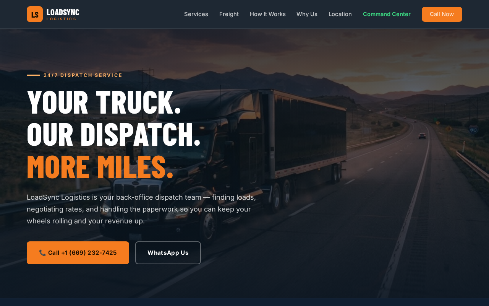

# LoadSync Logistics

**Live site: [loadsync-logistics.vercel.app](https://loadsync-logistics.vercel.app/)**

A conversion-focused marketing site for a 24/7 truck dispatching service serving owner-operators and small fleets (1–20 trucks) in the US market. Built to turn visits into phone calls and WhatsApp chats.

## What it does

- Pitched hero with dual conversion paths: click-to-call and WhatsApp
- Full service breakdown: load finding, rate negotiation, paperwork, billing, route planning, TMS/ELD management
- Equipment sections for dry van, reefer, flatbed and auto transport, with a dedicated car-hauling specialization block
- A clear 4-step "how it works" funnel from sign-up to payment
- Trust-building "why us" section with concrete differentiators (3rd-shift coverage, McLeod/Samsara/Motive-trained dispatchers)
- Location and contact details with Google Maps integration

## Built with

- Pure HTML / CSS / JavaScript — no framework, no build step
- Responsive, mobile-first layout
- Deployed on Vercel with automatic deploys from this repo

---

**Muhammad Umair** — freelance web developer, Abbottabad, Pakistan

- Portfolio: [portfolio-3d-nine-alpha.vercel.app](https://portfolio-3d-nine-alpha.vercel.app/)
- GitHub: [github.com/umairkhn1](https://github.com/umairkhn1)
- Email: nsumair006@gmail.com
